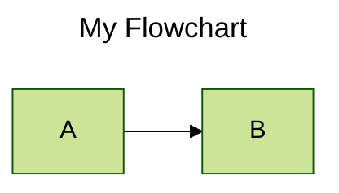

# Test

My first line.

## Summary

This is a summary

## Other Stuff

### This is a level 3 header

* item one
* item two
* item three

A **bold** item.

### Other Stuff

Stuff. This should have a distict link on the header from the the top-level Other Stuff header.

### Summary

More summary stuff. This should have a distict link on the header from the the top-level Summary header.

---

> A blockquote
> with info.

---

> [!NOTE]
>
> A note

---

> [!TIP]
>
> A tip

---

> [!IMPORTANT]
>
> Something important

---

> [!WARNING]
>
> A warning box

---

> [!CAUTION]
>
> A cautionary tale

---

[foo](http://example.com)

### Code

```json
{
  "foo": "bar"
}
```

```protobuf
message Foo {
    uint32 field1 = 1;
}
```



* [x] Action item 0
* [ ] Action item 1
* [ ] Action item 2
* foo

---

| Field | Type | Label  | Description   |
| ----- | ---- | ------ | ------------- |
| foo   | bar  | label1 | Some label    |
| foo2  | bar2 | label2 | Another label |

---

1. Ordered list item 1
2. Ordered list item2
3. Ordered list item3

A foonoted item[^1].
Another footnoted item[^†].
Yet another one[^§].
A 4th one[^>].

[^1]: First footnote. A symbol (>) in a footnote.
[^†]: Second footnote.
[^§]: Third footnote.
[^>]: Fourth footnote.

## Service: MyService

### Service Methods

#### Method Name

`QueryStuff`

#### Request Type

`StuffToQuery`

#### Response Type

`AnswerToQuery`

#### Description

The `QueryStuff` service method provides information about stuff. See the `StuffToQuery` and `AnswerToQuery` messages in `stuff.proto` for more information.
